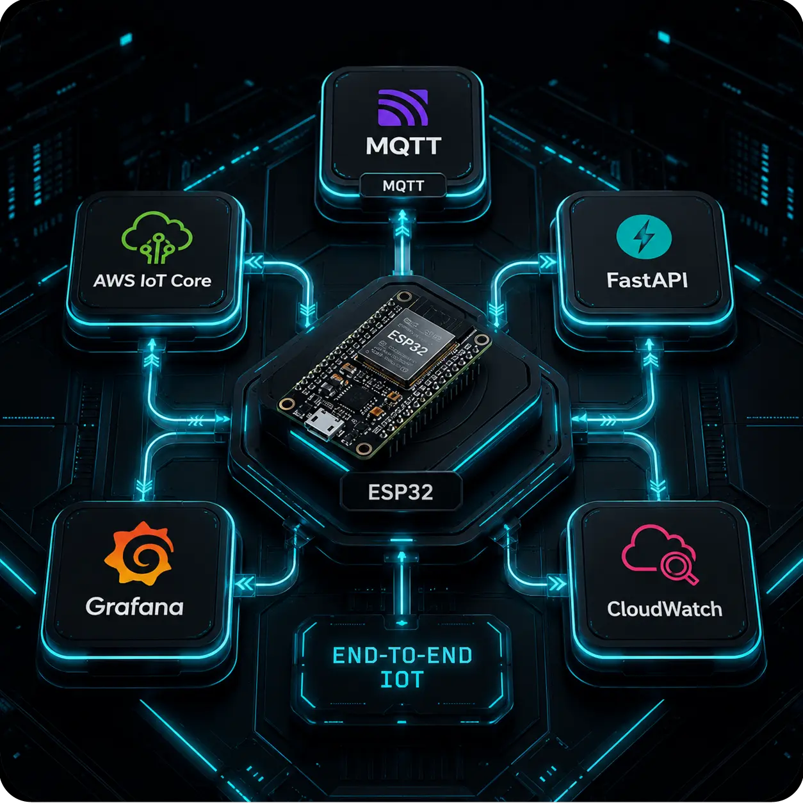

[🇬🇧 English](./README.en.md) | [🇺🇦 Українська](./README.uk.md)

# Повний проєкт

Центральна точка входу до всього проєкту: прошивки, бекенду, фронтенду та документації.

## Компоненти

| Компонент   | Опис                                     | Репозиторій                                                                             |
| ----------- | ---------------------------------------- | --------------------------------------------------------------------------------------- |
| **FW**      | Прошивка ESP32                           | [Відкрити FW](https://github.com/OleksiyPok/IoT_FW/tree/main)                           |
| **BE**      | Backend API та сервіси                   | [Відкрити BE](https://github.com/OleksiyPok/IoT_BE)                                     |
| **FE**      | Frontend-сторінка (інтегрована у бекенд) | [Відкрити FE](https://github.com/OleksiyPok/IoT_BE/tree/main/app/static)                |
| **Grafana** | Grafana json файл проекту                | [Відкрити Grafana](https://github.com/OleksiyPok/IoT_BE/tree/main/grafana/grafana.json) |
| **DOC**     | Документація проєкту та архітектура      | [Відкрити DOC](https://github.com/OleksiyPok/IoT_Project)                               |

## Структура репозиторію

- **FW** — прошивка та програмне забезпечення для вбудованих систем.
- **BE** — бекенд-застосунок, API.
- **FE** — фронтенд-застосунок та користувацький інтерфейс (інтегрований у бекенд).
- **DOC** — технічна документація, архітектурні діаграми.

## Примітки

- Кожен компонент підтримується в окремому репозиторії або гілці.
- Для доступу до вихідного коду використовуйте наведені вище посилання.
- Зміни в репозиторіях компонентів не оновлюють цей README автоматично.
- Цей репозиторій слугує центральним покажчиком компонентів і версій проєкту.

---
[🇬🇧 English](./README.en.md) | [🇺🇦 Українська](./README.uk.md)
